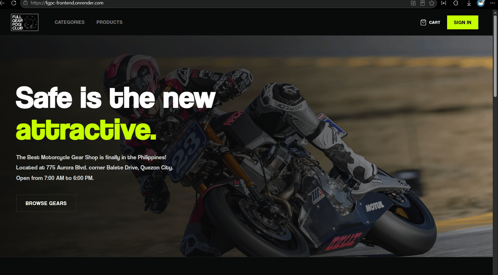
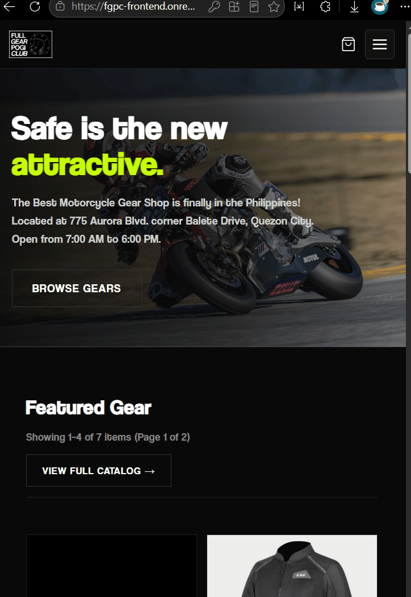

<!-- # Description -->

<p align="center">
  
  
</p>

<hr>

<p align="center">
  
  
  
  
  
  
</p>

<p align="center">
  A full-stack e-commerce web application built with the MERN stack for a made-up motorcycle gear shop named <strong>Full Gear Pogi Club (FGPC)</strong>. It gives riders a modern web shop to browse helmets, jackets, pants, boots, and armor, submit product reviews with profanity filtering, manage orders and return requests, and provides administrators with a complete dashboard for inventory management, sales analytics, and automated email receipts with PDF generation.
</p>

<p align="center">
  Try it here: <a href="https://fgpc-frontend.onrender.com/">https://fgpc-frontend.onrender.com/</a>
</p>

## Demo





## Technical Details

- **Language:** JavaScript (ES6+ / Node.js & React 19)
- **Database:** MongoDB (via Mongoose ODM) with support for local MongoDB and MongoDB Atlas
- **User Interface:** Custom dark motorcycle aesthetic (`#0A0A0A` background, `#C6FF00` neon accent) styled with CSS, paired with Material UI (MUI) DataGrid components and a mobile-optimized responsive layout featuring a burger navigation menu
- **Architecture:** Client-server REST API architecture. The Express backend handles routing, data validation, image uploads, email delivery, and JWT token sessions. The React frontend uses Redux for centralized state management and Axios for API communication.

The backend server starts from [`backend/server.js`](backend/server.js) on port 8000 (or `PORT` from environment). The frontend runs as a Single Page Application (SPA) built using Create React App.

## Packages I Used

### Backend Packages

- **`express`** 
- **`mongoose`** 
- **`dotenv`** 
- **`cors`** 
- **`cookie-parser`** 
- **`jsonwebtoken`** 
- **`bcryptjs`** 
- **`multer`** 
- **`cloudinary`** 
- **`nodemailer`** 
- **`pdfkit`** 
- **`bad-words`** 
- **`validator`** 
- **`firebase-admin`** 

### Frontend Packages

- **`react` & `react-dom`** 
- **`react-router-dom`** 
- **`redux` & `react-redux`** 
- **`redux-thunk`** 
- **`axios`** 
- **`@mui/material` & `@mui/x-data-grid`** 
- **`@emotion/react` & `@emotion/styled`** 
- **`formik`** 
- **`yup`** 
- **`react-hook-form`** 
- **`recharts`** 
- **`firebase`** 

## Features

- **Storefront & Catalog:**
  - Hero banner with quick shop links and responsive burger menu navigation.
  - Homepage best-seller pagination by 4s.
  - Products catalog with infinite scroll loading, category filter, price range inputs, and minimum star rating filter.
  - Multi-image carousel on product detail pages with thumbnail selector.
  - Out-of-stock items automatically placed at the end with distinct out-of-stock indicators.
- **Customer Account & Activity:**
  - User registration and login with Formik + Yup validation.
  - One-click Google / Gmail sign-in with Firebase.
  - Profile page with multiple shipping address management and avatar photo upload.
  - Combined "My Activity" dashboard displaying past orders, product reviews, and return requests in one place.
  - Order cancellation for pending orders, and order completion for delivered orders.
- **Review & Discussion System:**
  - Verified purchase restriction: customer can only rate and review gear they ordered and received.
  - Customers can edit their existing reviews and star ratings.
  - Automated profanity filter masking inappropriate words using `bad-words`.
  - Nested discussion replies with profile picture circles and role badges (`🛡️ Admin` vs `👤 Customer`).
- **Shopping Cart & Checkout:**
  - Persistent shopping cart supporting both guests and signed-in customers.
  - Quantity controls with live stock boundary limits.
  - Multi-step checkout with saved shipping address selection.
- **Admin Management & Dashboard:**
  - Administrative dashboard showing sales metrics, delivered net sales, top products, and top customers.
  - Interactive charts supporting date range filtering and toggle between Line and Bar charts.
  - Full CRUD operations with Material UI DataGrid tables for Products, Categories, Brands, Orders, Returns, Reviews, and Users.
  - Soft-delete support across products, categories, brands, orders, and reviews.
  - Admin reply to reviews and delete review / delete reply controls.
- **Email & PDF Receipts:**
  - Automated email dispatch via Nodemailer / Mailtrap when order status changes.
  - Email includes itemized list of gear, quantities, unit prices, subtotals, and grand total.
  - PDF receipt generated dynamically via PDFKit and attached directly to the email.
- **Mobile Responsive Design:**
  - Full responsive optimization for smartphones and tablets (`<= 768px` and `<= 480px`).
  - Mobile burger menu drawer with logo on the left and menu toggle on the right.
  - Mobile-friendly stacked cart view with touch-friendly quantity controls.

## Project Structure

```text
backend/
├── config/             Firebase Admin SDK configuration
├── Controllers/        Route controller handlers (auth, products, orders, reviews, etc.)
├── middlewares/        Authentication, role checks, and file upload middlewares
├── Models/             Mongoose data schemas (User, Product, Order, Review, Cart, etc.)
├── Routes/             Express API routes
├── utils/              JWT signing, cookies, Mailtrap emailer, PDFKit receipt generator, Cloudinary uploads
├── app.js              Express app configuration and CORS setup
└── server.js           Database connection and HTTP server listener

frontend/
├── public/             Static assets, index.html, manifest.json, and Render _redirects
└── src/
    ├── actions/        Redux action creators for authentication, cart, and resources
    ├── api/            Axios HTTP client configured with baseURL and Bearer token interceptor
    ├── assets/         Logos, branding imagery, and hero photos
    ├── components/     Reusable UI components (Catalog, Form, Layout, Product, Review, Table)
    ├── constants/      Redux action type constants
    ├── hooks/          Custom React hooks (useAuth)
    ├── pages/
    │   ├── admin/      Admin dashboard, products, categories, brands, orders, reviews, users
    │   └── store/      Storefront, catalog, product details, cart, checkout, profile, activity
    ├── reducers/       Redux reducers for auth, cart, and resource collections
    ├── utils/          Date formatters, price formatters, image URL resolvers
    ├── App.js          Root router, route protection, and dynamic title/favicon manager
    ├── index.js        React root entry point with Redux Provider
    └── index.css       Main custom CSS styling and responsive media queries
```

## Setup & Local Installation

### Prerequisites

- Node.js (version 18 or later)
- MongoDB running locally on `mongodb://127.0.0.1:27017/fgp` or a MongoDB Atlas cloud URI
- npm or yarn

### 1. Clone the repository

```bash
git clone <repository-url>
cd fgp-mern
```

### 2. Backend Setup

```bash
cd backend
npm install
```

Create a `.env` file inside the `backend/` directory (you can refer to `backend/render-env.txt` for all available keys):

```env
PORT=8000
NODE_ENV=development
MONGO_URI=mongodb://127.0.0.1:27017/fgp
JWT_SECRET=supersecretfgpjwtkey2026fgpcsecure
CLIENT_URL=http://localhost:3000

# Cloudinary (Image Hosting)
CLOUDINARY_ENABLED=true
CLOUDINARY_CLOUD_NAME=zde7dpud
CLOUDINARY_API_KEY=643555333758435
CLOUDINARY_API_SECRET=ZabXy0VqtGfzn2VPwrmotzT_b0Q

# Mailtrap (Email & PDF Receipts)
MAILTRAP_ENABLED=true
MAILTRAP_USER=d06f8760800fa0
MAILTRAP_PASS=c6053775ed89ea

# Render deployment toggle (leave false for local MongoDB)
DEPLOY_TO_RENDER=false
```

Start the backend:

```bash
npm start
```

### 3. Frontend Setup

In a new terminal window:

```bash
cd frontend
npm install
```

Start the React development server:

```bash
npm start
```

The store will open at [http://localhost:3000](http://localhost:3000) and the backend API will run on [http://localhost:8000](http://localhost:8000).

## Deployment (Render.com)

- **Backend:** Deployed as a Web Service. Run command: `node server.js`. Add environment variables from `backend/render-env.txt`.
- **Frontend:** Deployed as a Static Site. Build command: `npm install && npm run build`, Publish directory: `build`. Add rewrite rule `/* -> /index.html` (handled automatically via `frontend/public/_redirects`).
